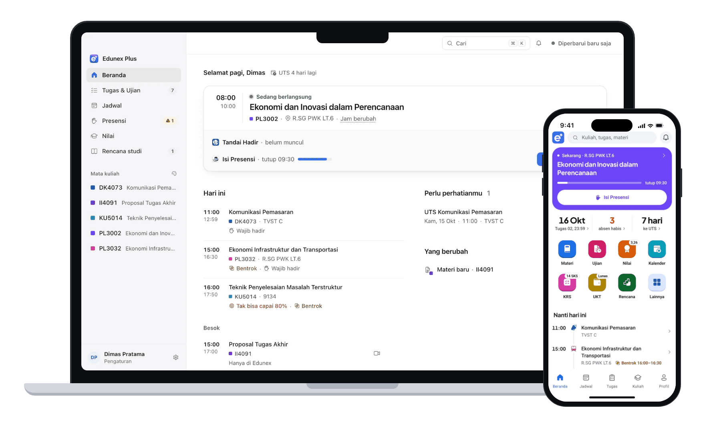
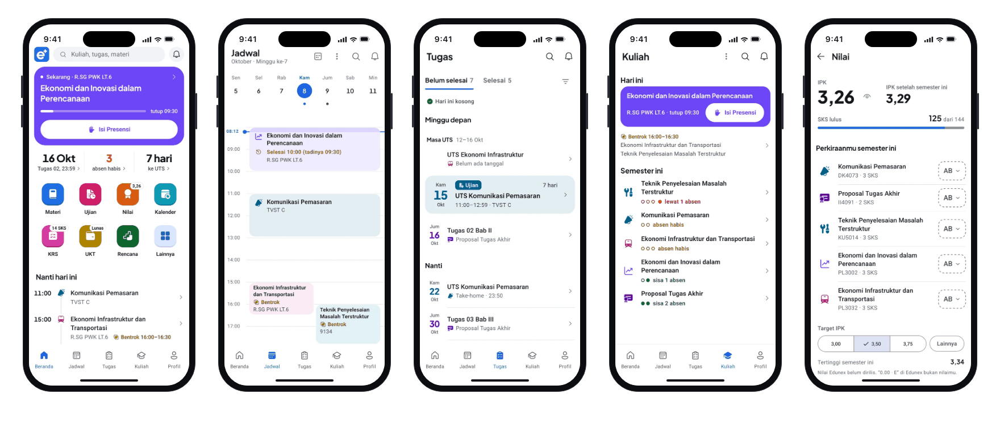
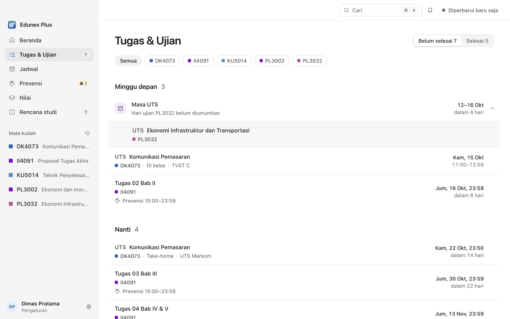
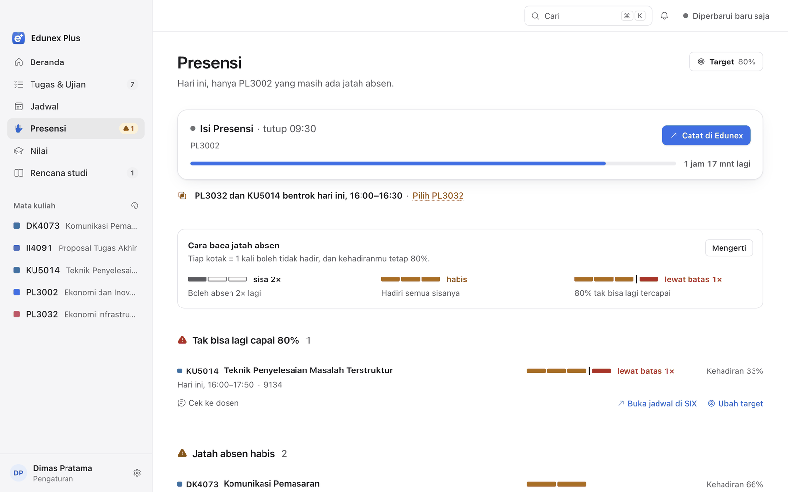
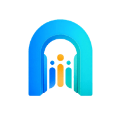

# Edunex Plus

**Edunex and SIX, finally in one place.** A free app for ITB students, on Android, iPhone,
Windows, macOS and Linux.

<picture>
  <source media="(prefers-color-scheme: dark)" srcset="docs/screenshots/hero-dark.png">
  
</picture>

<sub>Pictures come from the demo's made-up student, never a real account.</sub>

[Website](https://edunex-plus.arqilasp.com) · [Install with pictures](https://edunex-plus.arqilasp.com/en/install/) ·
[Download](#download) · [Privacy](docs/privacy.md) · [Code signing policy](docs/code-signing.md) ·
[Contributing](CONTRIBUTING.md)

> **Unofficial.** Built by students. Not made by, endorsed by or connected to ITB or Cognisia
> (the company behind Edunex). It uses your own Edunex and SIX sign-in, so your account stays
> your responsibility.

## What it does

Edunex holds what lecturers post. SIX holds what's official. Edunex Plus reads both and tells
you what needs you now:

- **Beranda:** today's classes, deadlines and anything urgent, most important first.
- **Tugas & Ujian:** every Task and exam with its real status. Save a draft or submit from the
  app.
- **Presensi:** how many more classes you can miss in each course, which ones have none left, and
  which class to go to when two clash. In class, it tells you the moment SIX's **Tandai Hadir**
  opens and takes you straight to it, and after class whether SIX counted it.
- **Courses:** modules, materials (Word, Excel, PowerPoint and PDF open in the app, and work
  offline), meetings and rooms.
- **Rencana studi:** your KRS, UKT bills and ITB's academic deadlines.
- **Alerts:** new Tasks, attendance opening, reminders you choose, on your phone and your
  computer.

It never marks attendance for you and never changes your KRS. Bahasa Indonesia and English,
light and dark.

### On your phone

The same app for Android and iPhone, laid out for one hand: Beranda, Jadwal, Tugas, Kuliah and
Profil along the bottom, the class on now with its **Isi Presensi** button on top, and widgets
for your home screen.

<picture>
  <source media="(prefers-color-scheme: dark)" srcset="docs/screenshots/phones-dark.png">
  
</picture>

### On your computer

| Tugas & Ujian | Presensi |
| --- | --- |
| <picture><source media="(prefers-color-scheme: dark)" srcset="docs/screenshots/tasks-dark.png"></picture> | <picture><source media="(prefers-color-scheme: dark)" srcset="docs/screenshots/presence-dark.png"></picture> |

## Download

Get the newest version from [Releases](https://github.com/pablonification/edunex-plus/releases),
under **Assets** (Windows or Linux on ARM: see the [install guide](docs/install.md#which-file-to-download)):

| Your device | File |
| --- | --- |
| Mac with Apple silicon (M1 or newer) | `Edunex-Plus-<version>-arm64.dmg` |
| Mac with Intel | `Edunex-Plus-<version>-x64.dmg` |
| Windows 10 or 11 | `Edunex-Plus-Setup-<version>.exe` |
| Ubuntu, Debian, Mint | `edunex-plus_<version>_amd64.deb` |
| Other Linux | `Edunex-Plus-<version>-x86_64.AppImage` |
| Android phone | `Edunex-Plus-<version>-android.apk` |
| iPhone | `Edunex-Plus-<version>-iphone.ipa` (you sign it with your own Apple ID: [steps](docs/install.md#iphone)) |

Your browser and your system warn you the first time you open each new version: few people have
downloaded it yet, and the Mac app isn't signed by Apple. The website's
[picture guides](https://edunex-plus.arqilasp.com/install/) show which button to press on each
device, and the [install guide](docs/install.md) has every case, plus updating and uninstalling. How the installers are signed:
the [code signing policy](docs/code-signing.md).

> **Alpha:** expect rough edges, and double-check anything important on Edunex or SIX itself.
> Something broke? [Open an issue](https://github.com/pablonification/edunex-plus/issues).

## Your data stays on your device

- You sign in on ITB's real Microsoft page. Your password never reaches the app.
- Your sign-in is locked by your system's own keychain. What the app reads is saved only on your
  phone or computer.
- It talks only to Edunex, SIX, ITB's public pages, GitHub (to check for updates), ntfy if you
  turn on phone alerts, and the maintainer's report relay when a problem report goes: when you
  press **Kirim langsung**, or by itself if you said so when the app asked. A report has your
  name, NIM, contacts and links replaced and your grades and amounts made up first. The whole
  report stays private for the maintainer; the public GitHub issue gets only its summary.
  **Settings → Laporan masalah** stops it sending by itself. No analytics, no tracking.
- **Settings → Keluar & hapus data** signs you out and removes your courses, grades, plans and
  notes from the device.

Full details: [docs/privacy.md](docs/privacy.md).

## Build it yourself

You need Node.js 22.

```sh
npm ci
npm run dev     # the app, with live reload
npm run demo    # the app on made-up data, no account needed
npm run site    # the website, on this computer
npm run check   # lint, types and tests: what every pull request must pass
```

Installers: `npm run package:mac`, `package:win` or `package:linux` (into `release/`). The phone
app (`mobile/`) is built in GitHub Actions: [CONTRIBUTING.md, "The phone app"](CONTRIBUTING.md#the-phone-app).

## Contributing

Start with [CONTRIBUTING.md](CONTRIBUTING.md). The repository is public, so **never paste real
student data** anywhere: use the demo. Security problems go through a
[private report](SECURITY.md), and everyone follows the [code of conduct](CODE_OF_CONDUCT.md).

**Where to find things** (for people and AI agents; agents also read [AGENTS.md](AGENTS.md)):

| Read | For |
| --- | --- |
| [CONTEXT.md](CONTEXT.md) | The words the project uses (Task, Presence, KRS, Kehadiran…) |
| [docs/adr/](docs/adr/) | How it's built and why |
| [API.md](API.md), [SIX.md](SIX.md) | How the app reads Edunex and SIX |
| [docs/fix-bot.md](docs/fix-bot.md) | The bot that drafts a fix when the app can't read a page a Student reported |
| [docs/design-system.md](docs/design-system.md) | The look |
| [mobile/AGENTS.md](mobile/AGENTS.md), [mobile/IOS.md](mobile/IOS.md) | The phone app: how it's put together, and the iPhone build |
| [site/README.md](site/README.md) | The website |
| [docs/test-data.md](docs/test-data.md), [docs/scenarios.md](docs/scenarios.md) | How tests work |
| [docs/platform-notifications.md](docs/platform-notifications.md) | Notifications on each system and the phone |
| [docs/code-signing.md](docs/code-signing.md), [docs/research/](docs/research/) | How the installers are signed, and why browsers warn about them |
| [docs/relay.md](docs/relay.md) | How a Student's problem report becomes an issue here, and setting up the relay that files it |

## Supported by

<a href="https://ganesaspace.com"></a>

**[Ganesa Space](https://ganesaspace.com)**

## License

[MIT](LICENSE). The open-source software inside the app, with each licence, is listed in
**Settings → Tentang → Lisensi sumber terbuka**.
