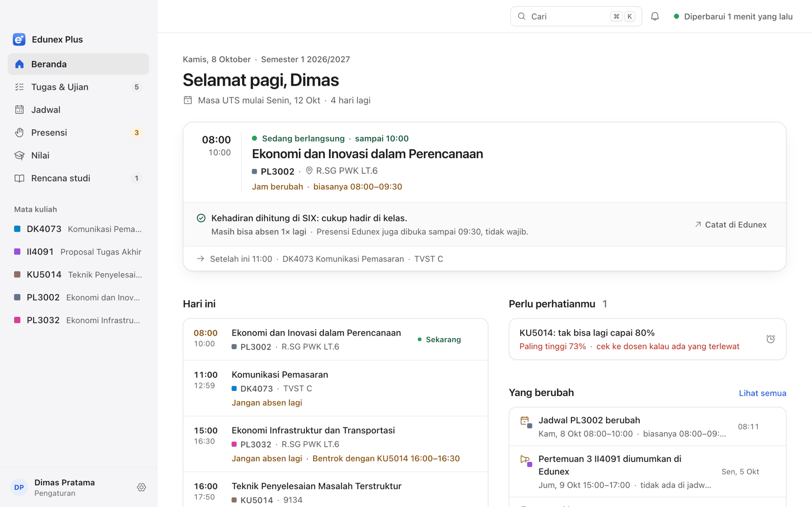
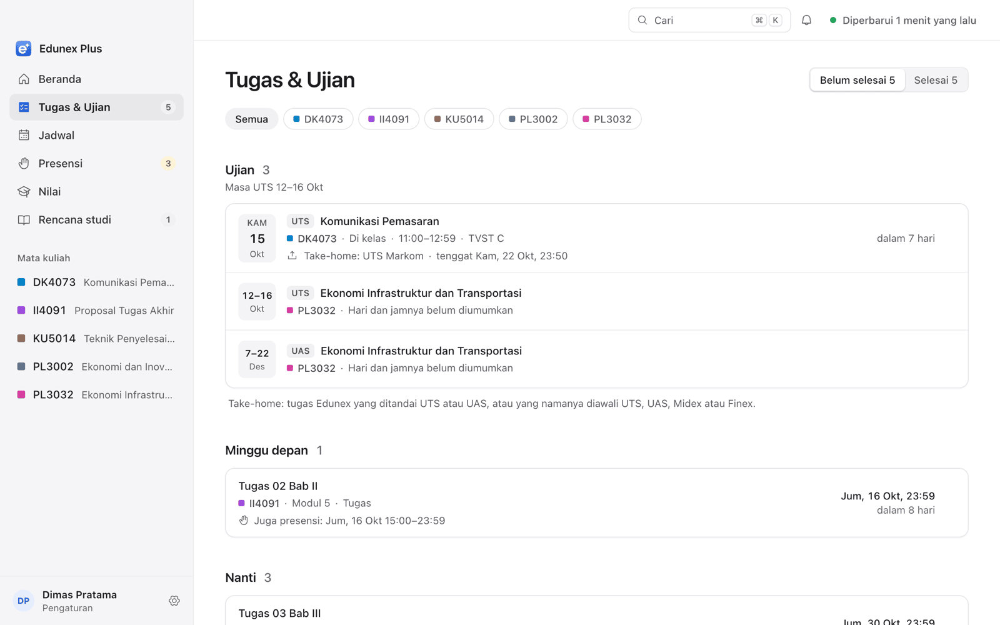
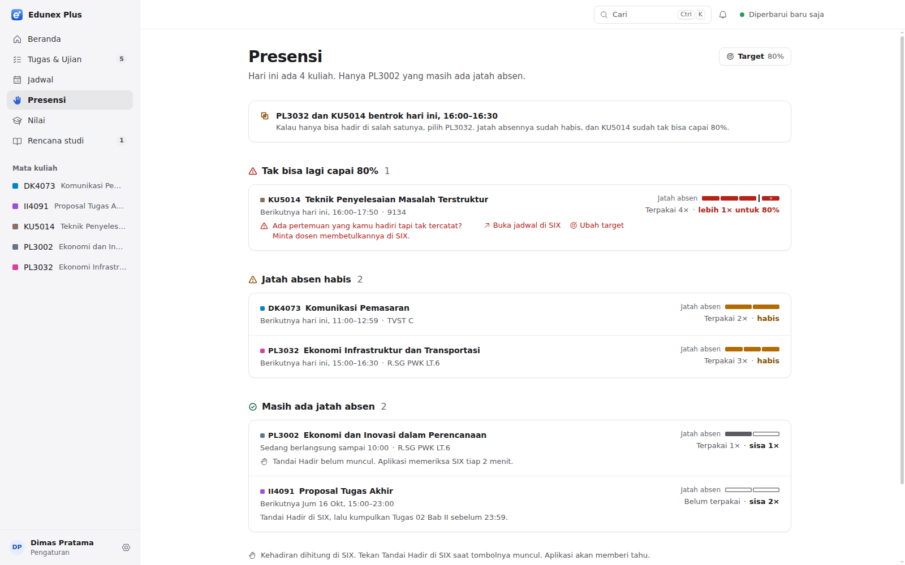
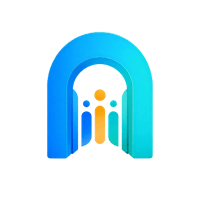

# Edunex Plus

**Edunex and SIX in one calm window.** A free desktop app for ITB students, on macOS, Windows
and Linux.

<picture>
  <source media="(prefers-color-scheme: dark)" srcset="docs/screenshots/home-dark.png">
  
</picture>

<sub>Pictures come from the demo's made-up student, never a real account.</sub>

[Download](#download) · [Install guide](docs/install.md) · [Privacy](docs/privacy.md) ·
[Contributing](CONTRIBUTING.md)

> **Unofficial.** Built by students. Not made by, endorsed by or connected to ITB or Cognisia
> (the company behind Edunex). It uses your own Edunex and SIX sign-in, so your account stays
> your responsibility.

## What it does

Edunex holds what lecturers post. SIX holds what's official. Edunex Plus reads both and tells
you what needs you now:

- **Beranda:** today's classes, deadlines and anything urgent, most important first.
- **Tugas & Ujian:** every Task and exam with its real status. Save a draft or submit from the
  app.
- **Presensi:** your attendance count per course and how many absences you have left.
- **Courses:** modules, materials (Word, Excel, PowerPoint and PDF open in the app, and work
  offline), meetings and rooms.
- **Rencana studi:** your KRS, UKT bills and ITB's academic deadlines.
- **Alerts:** new Tasks, attendance opening, reminders you choose. On your computer, and on your
  phone too if you want.

| Tugas & Ujian | Presensi |
| --- | --- |
|  |  |

It never marks attendance for you and never changes your KRS. Bahasa Indonesia and English,
light and dark.

## Download

Get the newest version from [Releases](https://github.com/pablonification/edunex-plus/releases),
under **Assets** (Linux on ARM: see the [install guide](docs/install.md#which-file-to-download)):

| Your computer | File |
| --- | --- |
| Mac with Apple silicon (M1 or newer) | `Edunex.Plus-<version>-arm64.dmg` |
| Windows 10 or 11 | `Edunex.Plus.Setup.<version>.exe` |
| Ubuntu, Debian, Mint | `edunex-plus_<version>_amd64.deb` |
| Other Linux | `Edunex.Plus-<version>.AppImage` |

The app isn't signed yet, so macOS and Windows warn you the first time you open it. The
[install guide](docs/install.md) shows the one step to get past that, plus updating and
uninstalling.

> **Alpha:** expect rough edges, and double-check anything important on Edunex or SIX itself.
> Something broke? [Open an issue](https://github.com/pablonification/edunex-plus/issues).

## Your data stays on your computer

- You sign in on ITB's real Microsoft page. Your password never reaches the app.
- Your sign-in is locked in your system's keychain. What the app reads is saved only on your
  computer.
- It talks only to Edunex, SIX, ITB's public pages, GitHub (to check for updates) and, if you
  turn on phone alerts, ntfy. No analytics, no tracking.
- **Settings → Keluar** removes everything it saved.

Full details: [docs/privacy.md](docs/privacy.md).

## Build it yourself

You need Node.js 22.

```sh
npm ci
npm run dev     # the app, with live reload
npm run demo    # the app on made-up data, no account needed
npm run check   # lint, types and tests: what every pull request must pass
```

Installers: `npm run package:mac`, `package:win` or `package:linux` (into `release/`).

## Contributing

Start with [CONTRIBUTING.md](CONTRIBUTING.md). The repository is public, so **never paste real
student data** anywhere: use the demo. Security problems go through a
[private report](SECURITY.md), and everyone follows the [code of conduct](CODE_OF_CONDUCT.md).

**Where to find things** (for people and AI agents; agents also read [AGENTS.md](AGENTS.md)):

| Read | For |
| --- | --- |
| [CONTEXT.md](CONTEXT.md) | The words the project uses (Task, Presence, KRS, Kehadiran…) |
| [docs/adr/](docs/adr/) | How it's built and why |
| [API.md](API.md), [SIX.md](SIX.md) | How the app reads Edunex and SIX |
| [docs/design-system.md](docs/design-system.md) | The look |
| [docs/test-data.md](docs/test-data.md), [docs/scenarios.md](docs/scenarios.md) | How tests work |
| [docs/platform-notifications.md](docs/platform-notifications.md) | Notifications on each system and the phone |

## Supported by

<a href="https://ganesaspace.com"></a>

**[Ganesa Space](https://ganesaspace.com)**

## License

[MIT](LICENSE). The open-source software inside the app, with each licence, is listed in
**Settings → Tentang → Lisensi sumber terbuka**.
